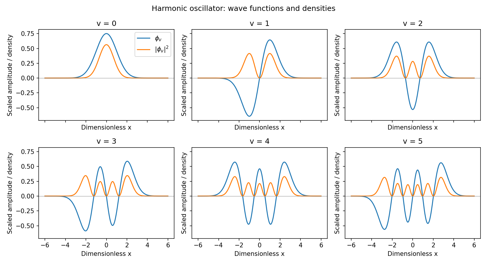
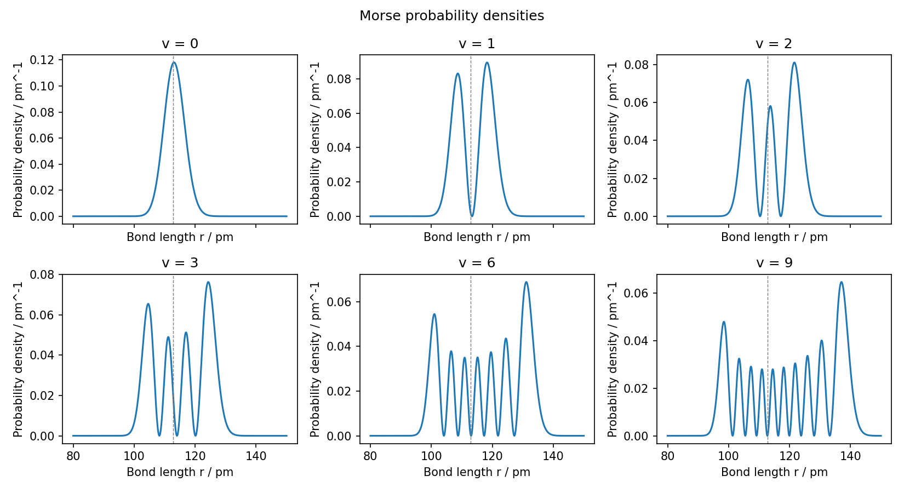
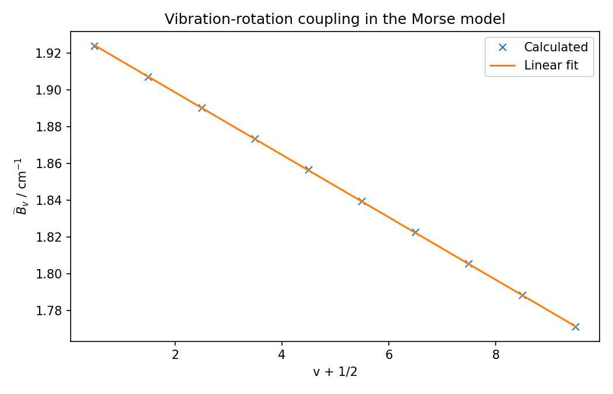

# Harmonic and Morse oscillators

**Judy Wu · Experiment C3 — IB Chem A**

A computational chemistry coursework project exploring molecular vibration with Python. It compares harmonic and Morse wave functions, calculates probability distributions and expectation values, and estimates vibration–rotation coupling for a CO model.

## What this project demonstrates

- Special functions: Hermite and generalized Laguerre polynomials.
- Numerical normalisation, integration and expectation values.
- Classical turning points and probability in classically forbidden regions.
- Harmonic versus anharmonic potential-energy curves.
- Unit conversion, stable numerical evaluation and regression of model-generated rotational constants.

## Run in Colab

Upload [`oscillator_analysis.ipynb`](oscillator_analysis.ipynb) to [Google Colab](https://colab.research.google.com/) and run all cells. No GPU or external data is needed. If imports are missing, run `%pip install numpy scipy matplotlib` in a separate cell.

The delivered notebook includes verified outputs for browsing on GitHub. Running it again regenerates figures under `figures/` and numerical tables under `results/` in the current working directory.

## Run locally

From this project folder:

```bash
python3 -m venv .venv
source .venv/bin/activate
python -m pip install -r requirements.txt
```

On Windows, activate with `.venv\Scripts\activate`. Open the notebook in VS Code with its Python and Jupyter extensions, selecting this environment as the kernel. Alternatively, run `python -m jupyterlab`.

## Harmonic oscillator

The harmonic section uses dimensionless coordinates with hbar, mass and angular frequency set to one. For v=0,...,5, numerical checks verify normalisation, zero mean displacement and mean-square displacement v + 1/2. The ground-state probability beyond the classical turning points is checked against erfc(1).



## Morse oscillator and CO model

The potential sweeps use arbitrary units. The separate CO calculation retains the supplied input parameters: masses 12 u and 15.995 u, equilibrium distance 112.8 pm, vibrational wavenumber 2170 cm⁻¹, and anharmonicity product 13.29 cm⁻¹. These are course inputs, not measurements independently verified for this repository.



The calculated rotational constants decrease with vibrational quantum number. Fitting `B_v = B_e - alpha_e (v + 1/2)` gives approximately **B_e = 1.933 cm⁻¹**, **alpha_e = 0.0170 cm⁻¹**, and an inferred equilibrium distance of **112.8 pm**. Alpha is the negative of the fitted slope under this convention.



These results describe a model calculation. Recovering an equilibrium distance close to an input parameter checks internal consistency, not independent experimental accuracy. Regression standard errors do not include uncertainties in the molecular inputs.

## Numerical scope

Morse moments are calculated over **60–200 pm**, normalised by the probability in that window, and checked against **50–220 pm**. The probability in the original 80–150 pm window is also exported. Integrating in picometres avoids applying default absolute tolerances directly to very small SI moments.

The inverse-square moment is a finite-window estimate: this near-equilibrium Morse model does not impose a radial boundary condition at r=0. No claim is made about the exact singular-endpoint integral. Numerical checks cover the low states used here, not arbitrary parameters or near-dissociation states.

The stable amplitude calculation uses SciPy's [direct Laguerre evaluation](https://docs.scipy.org/doc/scipy/reference/generated/scipy.special.eval_genlaguerre.html) and [log-gamma function](https://docs.scipy.org/doc/scipy/reference/generated/scipy.special.gammaln.html). Original outputs are preserved separately from the prepared run; see [result provenance](results/README.md).

## Files

```text
oscillator_analysis.ipynb    Notebook with verified outputs
requirements.txt            Local runtime and notebook dependencies
.gitignore                  Excludes local environments and temporary files
figures/                    Twelve regenerated figures
results/                    Historical output, new CSVs and validation record
```

## Attribution

I (Judy Wu) created this as coursework: Experiment C1 — IB Chem for my Natural Sciences course at Cambridge. 
